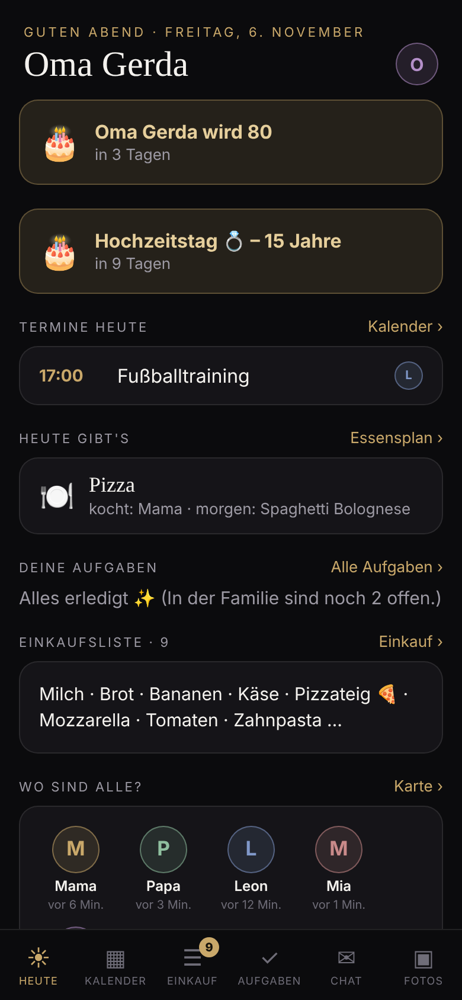
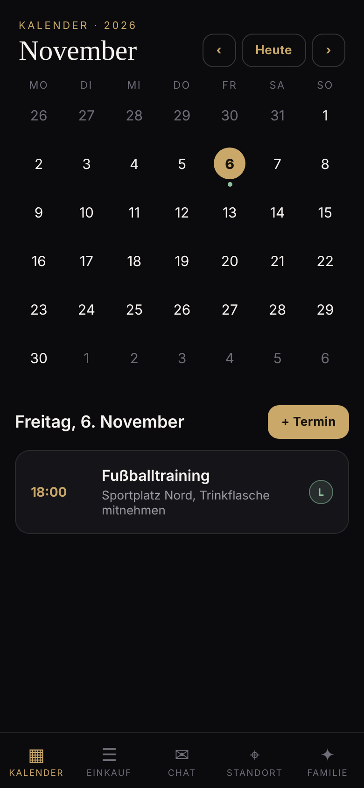
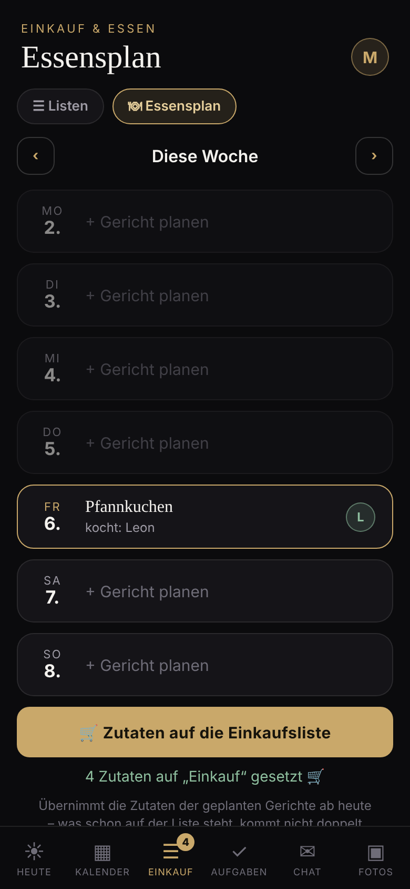
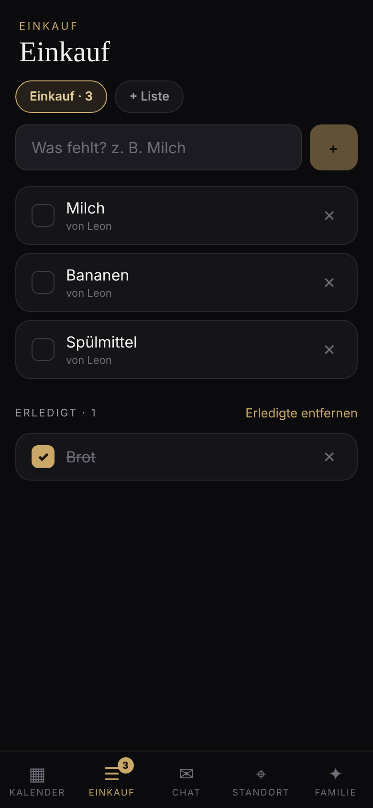
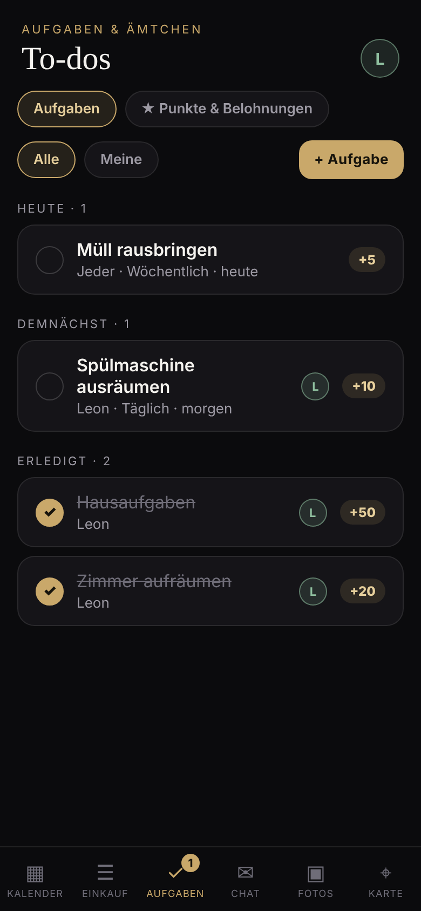
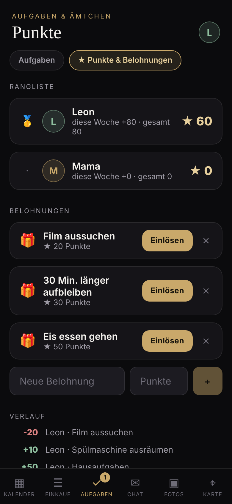
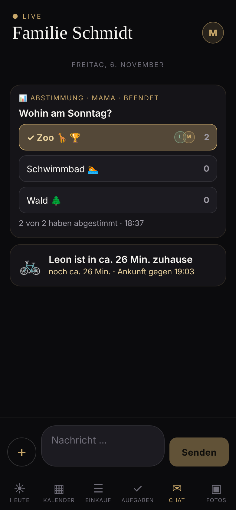
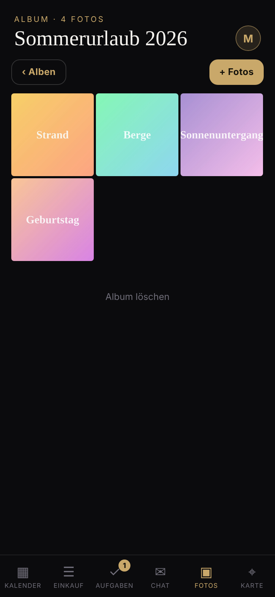
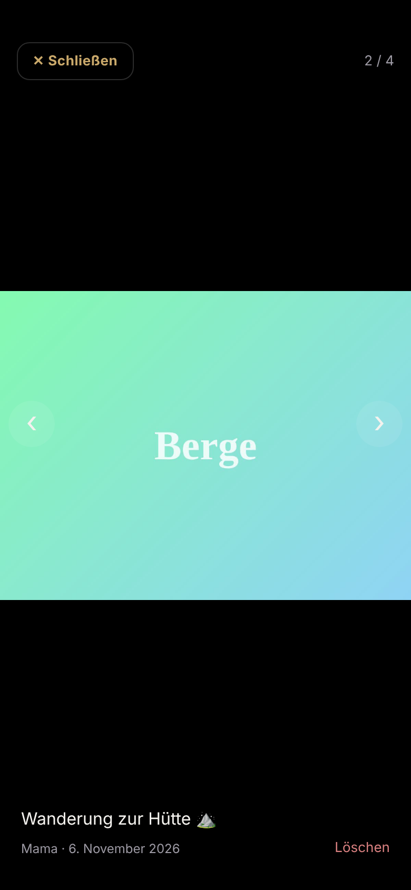
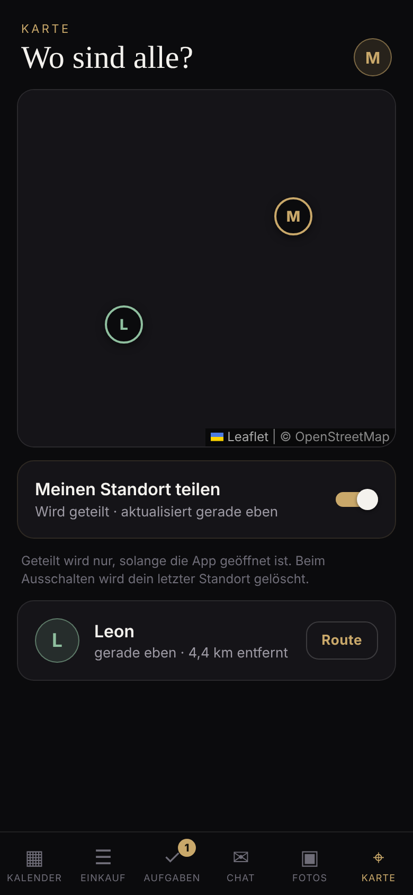

# Familie – die App für eure Familie

Eine private App nur für eure Familie: **Tagesüberblick „Heute“**, **geteilter Kalender**
mit Serien und Geburtstagen, **Essensplan**, **Einkaufslisten**,
**Aufgaben mit Punkten & Belohnungen**, **Familien-Chat**, **Fotoalben** und eine
**Familienkarte**. Alles wird **in Echtzeit** synchronisiert, mit
**Push-Benachrichtigungen** auf dem Handy.

| Heute | Kalender | Essensplan | Einkauf |
| --- | --- | --- | --- |
|  |  |  |  |

| Aufgaben | Punkte |
| --- | --- |
|  |  |

| Chat | Fotoalbum | Foto-Vollbild | Karte |
| --- | --- | --- | --- |
|  |  |  |  |

| Ordner     | Was                                                                                       |
| ---------- | ----------------------------------------------------------------------------------------- |
| `backend/` | API + WebSocket-Server (Node + TypeScript), Daten als JSON-Datei, Fotos als Dateien.      |
| `app/`     | Mobile-App (Expo / React Native + TypeScript) für iOS, Android und Web.                  |
| `Dockerfile`, `docker-compose.yml`, `Caddyfile` | Online-Betrieb mit automatischem HTTPS.             |

## Funktionen

- **Familie gründen / beitreten:** Wer gründet, bekommt einen 6-stelligen
  **Einladungscode** zum Weitergeben. Es gibt kein Passwort und keine E-Mail, jedes
  Gerät bekommt einen eigenen geheimen Schlüssel. Zu den Einstellungen kommst du über
  deinen **Avatar oben rechts**.
- **Heute (Startseite):** alles für den Tag auf einen Blick: anstehende Geburtstage,
  heutige Termine, was es zu essen gibt (und wer kocht), deine fälligen Aufgaben zum
  direkten Abhaken, die Einkaufsliste, wo alle sind, und die letzte Chat-Nachricht. Jeder
  Bereich führt direkt zum passenden Tab, und von hier aus geht es auch zur Karte.
- **Kalender:** Monatsansicht mit farbigen Punkten pro Person. Termine sind ganztägig
  oder mit Uhrzeit, mit Notiz und „für wen?“. Sie können sich **wiederholen**
  (wöchentlich, alle 2 Wochen, monatlich, jährlich, markiert mit ↻). Die Vorkommen
  berechnet die App in der lokalen Zeitzone, so bleibt „dienstags 17 Uhr“ auch nach der
  Zeitumstellung 17 Uhr.
- **Geburtstage & Jahrestage:** einmal eintragen (mit Geburtsjahr, wenn bekannt).
  Sie erscheinen im Kalender (🎂) und als Hinweis auf „Heute“ („Oma Gerda wird 80 – in
  3 Tagen“). Auf dem Handy gibt es eine Erinnerung eine Woche vorher und am Tag selbst.
- **Essensplan:** im Einkaufs-Tab. Pro Tag ein Gericht aus euren Rezepten (oder frei
  eingetragen) und wer kocht. **„Zutaten auf die Einkaufsliste“** überträgt alle Zutaten
  der geplanten Gerichte ab heute, Doppeltes kommt nicht noch einmal drauf.
- **Einkaufslisten:** mehrere Listen, abhaken, „Erledigte entfernen“, Zähler am Tab.
- **Aufgaben & Ämtchen:** einmalig, täglich oder wöchentlich, für eine Person oder für
  jeden, mit Fälligkeit und Punkten (★ 5–50). Wiederkehrende Aufgaben rücken nach dem
  Abhaken automatisch weiter. Eltern können für ein Kind abhaken, die Punkte bekommt
  dann der oder die Zuständige.
- **Punkte & Belohnungen:** Rangliste (Woche und gesamt), selbst definierte Belohnungen
  („Eis essen gehen – ★ 50“) und ein Verlauf. Wer zu wenig Punkte hat, kann nicht einlösen.
- **Chat:** Familien-Gruppenchat mit Tagestrennern und Live-Anzeige. Über **„+“** gibt es:
  - **📊 Abstimmungen:** Frage und 2 bis 8 Antworten (optional Mehrfachauswahl), Ergebnisse
    live als Balken mit den Avataren der Abstimmenden. Wer gefragt hat, kann beenden, die
    Gewinner-Antwort bekommt einen 🏆.
  - **🏠 Bin gleich da:** Verkehrsmittel wählen (zu Fuß, Rad, Auto, Bus & Bahn), die App
    schätzt die Zeit bis nach Hause (oder du wählst 5–60 Min.). Im Chat und auf „Heute“
    steht dann „Leon ist auf dem Heimweg – noch ca. 7 Min.“. Wer den Standort teilt, wird
    **automatisch als angekommen gemeldet**, sobald er weniger als 150 m von zuhause
    entfernt ist. Sonst gibt es einen Knopf „Bin angekommen“. Das Zuhause legt ihr einmal
    in den Einstellungen fest.
- **Fotoalben:** Alben anlegen, **mehrere Fotos auf einmal** hochladen (oder direkt mit
  der Kamera). Fotos werden vorher auf max. 1600 px verkleinert und als JPEG
  komprimiert, das spart Datenvolumen und entfernt die GPS-Daten aus den Fotos.
  Vollbild zum Wischen und Beschreibungen. Fotos sind nur für angemeldete
  Familienmitglieder abrufbar.
- **Karte:** freiwilliges Standort-Teilen mit Pins aller Mitglieder (Apple/Google Maps
  in der App, OpenStreetMap im Browser), Entfernung, „Route“-Knopf. Geteilt wird nur,
  solange die App offen ist (in jedem Tab). Beim Ausschalten wird der Standort sofort
  gelöscht.
- **Benachrichtigungen:** Push bei neuen Nachrichten, Terminen, Aufgaben für dich,
  erledigten Aufgaben, eingelösten Belohnungen, neuen Fotos und neuen Mitgliedern.
  Dazu **Termin-Erinnerungen** 30 Min. vorher (ganztägige um 8 Uhr), die direkt auf
  dem Handy geplant werden. Ein Tipp auf die Benachrichtigung öffnet den passenden Tab.

## Schnellstart (lokal)

```bash
# Backend
cd familie/backend
npm install
npm start            # http://localhost:4100, Daten in data/
npm run smoke        # End-to-End-Test der API

# App (zweites Terminal)
cd familie/app
npm install
npm start            # QR-Code mit „Expo Go“ scannen
npm run web          # oder im Browser
```

> **Echte Handys im WLAN:** `localhost` zeigt auf das Handy selbst. Beim Einrichten auf
> „Server: … · ändern“ tippen und die **LAN-IP deines Rechners** eintragen, z. B.
> `http://192.168.1.20:4100`.

## Demo-Version (ohne Server)

`npm run export:demo` im Ordner `app/` baut eine Web-Version, in der das Backend
direkt im Browser läuft (`src/demo/server.ts`). Sie bringt eine fertig befüllte
Beispiel-Familie mit (Einladungscode `DEMO42`), die Familie antwortet im Chat, und der
Standort wird simuliert. Alle Daten bleiben auf dem Gerät. Ideal, um die App
herzuzeigen, ohne etwas zu installieren.

## Online stellen (unterwegs nutzbar)

Du brauchst einen kleinen Server mit Docker (z. B. einen günstigen VPS oder einen
Raspberry Pi zu Hause) und eine **Domain**, deren DNS-Eintrag auf den Server zeigt.

```bash
cd familie
cp .env.example .env          # DOMAIN=familie.deine-domain.de eintragen
docker compose up -d --build
```

Das war's: [Caddy](https://caddyserver.com) holt automatisch ein HTTPS-Zertifikat, und
unter `https://familie.deine-domain.de` läuft sofort die **Web-Version** der App. In
der Handy-App trägst du beim Einrichten diese Adresse als Server ein. Alternativ baust
du die App mit `EXPO_PUBLIC_API_URL=https://familie.deine-domain.de` (dann ist sie
voreingestellt).

- **Daten & Fotos** liegen im Docker-Volume `familie-data`. Regelmäßig sichern, z. B.
  `docker run --rm -v familie_familie-data:/d -v "$PWD":/b alpine tar czf /b/backup.tgz -C /d .`
- **Sicherheit:** Einladungscodes sind gegen Durchprobieren geschützt (max. 10
  Fehlversuche pro IP in 15 Min.). Jede Familie sieht nur ihre eigenen Daten. Falls
  ein Code in falsche Hände gerät: „Neuer Code“ in den Einstellungen.
- Umgebungsvariablen des Backends: `PORT`, `DATA_DIR`, `WEB_DIR`, `PUSH=off`,
  `TRUST_PROXY`, `TZ`.

## Push-Benachrichtigungen einrichten (einmalig)

Push läuft über den kostenlosen Expo-Push-Dienst. Dafür braucht die App eine
Expo-Projekt-ID:

```bash
cd familie/app
npx eas-cli login     # kostenloses Expo-Konto
npx eas-cli init      # trägt extra.eas.projectId in app.json ein
```

Ohne Projekt-ID funktioniert alles andere weiter, auch die Termin-Erinnerungen. In den
Einstellungen der App steht, ob Push aktiv ist. Hinweis: In **Expo Go auf Android**
sind Push-Benachrichtigungen eingeschränkt. Für die volle Funktion eine eigene App
bauen (`npx eas-cli build --profile preview`).

## Technik in Kürze

- **Echtzeit:** Die App hält eine WebSocket-Verbindung (`/ws?token=…`). Der Server
  schickt nur Hinweise wie `{"type":"changed","topic":"tasks"}`, die App lädt dann
  genau diesen Bereich nach. Bei Funklöchern verbindet sie sich automatisch neu.
- **Fotos:** Upload als Base64 im JSON (identisch auf iOS, Android und Web). Der Server
  prüft den Dateityp anhand der Bytes (JPEG, PNG, WebP, max. 10 MB).
- **Punkte:** Jede erledigte Aufgabe und jede eingelöste Belohnung ist eine Buchung. Der
  Kontostand ist jederzeit nachvollziehbar und „rückgängig“ storniert sauber.
- **Speicher:** bewusst einfach, eine JSON-Datei, gebündelt und atomar geschrieben.
  Später lässt sich das durch SQLite oder Postgres ersetzen, ohne die API zu ändern.

### API-Überblick

| Bereich    | Routen |
| ---------- | ------ |
| Familie    | `POST /families`, `POST /families/join`, `GET/PATCH/DELETE /me`, `POST/DELETE /me/push-token`, `POST /family/invite-code` |
| Kalender   | `GET /events?from&to`, `POST /events`, `PATCH/DELETE /events/:id` (mit `repeat`, `repeatUntil`) |
| Geburtstage| `GET/POST /birthdays`, `PATCH/DELETE /birthdays/:id` |
| Essen      | `GET/POST /recipes`, `PATCH/DELETE /recipes/:id`, `GET /meals?from&to`, `PUT/DELETE /meals/:date`, `POST /meals/to-shopping` |
| Einkauf    | `GET/POST /lists`, `PATCH/DELETE /lists/:id`, `POST /lists/:id/items`, `POST /lists/:id/clear-done`, `PATCH/DELETE /items/:id` |
| Aufgaben   | `GET/POST /tasks`, `PATCH/DELETE /tasks/:id`, `POST /tasks/:id/complete`, `POST /tasks/:id/uncomplete` |
| Punkte     | `GET /points`, `GET/POST /rewards`, `DELETE /rewards/:id`, `POST /rewards/:id/redeem` |
| Chat       | `GET /messages`, `POST /messages`, `POST /polls`, `POST /messages/:id/vote`, `POST /messages/:id/close`, `POST /messages/eta`, `POST /messages/:id/arrived` |
| Zuhause    | `PUT/DELETE /family/home` |
| Fotos      | `GET/POST /albums`, `PATCH/DELETE /albums/:id`, `GET/POST /albums/:id/photos`, `PATCH/DELETE /photos/:id`, `GET /photos/:id/file` |
| Standort   | `GET /locations`, `PUT/DELETE /locations/me` |

## Ideen für später

- Standort im Hintergrund und „Angekommen zuhause“-Hinweise (braucht eine eigene App-Version)
- Familien-Tresor, Kinder-Modus, Wochensieger bei den Aufgaben
- Echte Routenzeiten (statt Luftlinien-Schätzung) über einen Routing-Dienst
- Fotos direkt im Chat teilen, Videos im Album
- Datenbank (SQLite) für große Familien bzw. viele Fotos
