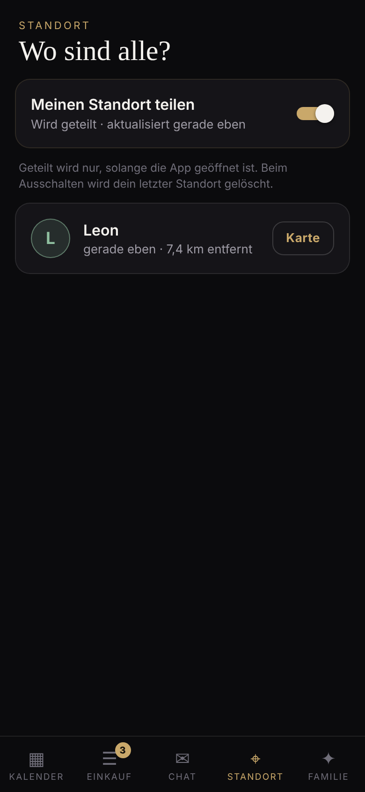

# Familie – die App für eure Familie

Eine private App nur für eure Familie mit **geteiltem Kalender**, **Einkaufslisten**,
**Familien-Chat** und **Standort teilen**. Alles wird **in Echtzeit** synchronisiert:
Trägt jemand „Milch“ ein, steht sie sofort auf allen Handys.

| Kalender | Einkauf | Chat | Standort |
| --- | --- | --- | --- |
|  |  |  |  |

| Ordner     | Was                                                                          |
| ---------- | ---------------------------------------------------------------------------- |
| `backend/` | API + WebSocket-Server (Node + TypeScript), speichert alles in einer JSON-Datei. |
| `app/`     | Mobile-App (Expo / React Native + TypeScript) für iOS, Android und Web.     |

## Funktionen

- **Familie gründen / beitreten:** Wer gründet, bekommt einen 6-stelligen
  **Einladungscode**. Den schickst du der Familie („Einladen“-Button). Es gibt kein
  Passwort und keine E-Mail, jedes Gerät bekommt einen eigenen geheimen Schlüssel.
- **Kalender:** Monatsansicht mit farbigen Punkten pro Person. Termine sind ganztägig
  oder mit Uhrzeit, mit Notiz und „für wen?“ (einzelne Personen oder die ganze Familie).
- **Einkaufslisten:** mehrere Listen (z. B. „Einkauf“, „Drogerie“). Abhaken, löschen,
  „Erledigte entfernen“, Zähler am Tab und „von Leon“ an jedem Eintrag.
- **Chat:** Familien-Gruppenchat mit Tagestrennern und Live-Anzeige.
- **Standort:** freiwillig per Schalter. Zeigt, wer wo ist („vor 5 Min. · 2,3 km
  entfernt“) und öffnet die Position in Apple/Google Maps. Geteilt wird nur, solange die
  App offen ist. Beim Ausschalten wird der letzte Standort sofort vom Server gelöscht.
- **Familie:** Mitglieder, eigenen Namen ändern, neuen Einladungscode erzeugen,
  Familie verlassen.

## Schnellstart

### 1. Backend

```bash
cd familie/backend
npm install
npm start            # http://localhost:4100, Daten in data/db.json
npm run smoke        # End-to-End-Test der API inkl. Echtzeit
```

### 2. App

```bash
cd familie/app
npm install
npm start            # QR-Code mit „Expo Go“ scannen
npm run web          # oder im Browser testen
```

> **Echte Handys:** `localhost` zeigt auf das Handy selbst. Beim Einrichten in der App
> auf „Server: … · ändern“ tippen und die **LAN-IP deines Rechners** eintragen, z. B.
> `http://192.168.1.20:4100`. Handy und Rechner müssen im selben WLAN sein.
> Damit es auch **unterwegs** funktioniert, muss das Backend im Internet erreichbar
> sein, z. B. auf einem kleinen Server oder einem Raspberry Pi mit HTTPS.

## Technik in Kürze

- **Echtzeit:** Die App hält eine WebSocket-Verbindung (`/ws?token=…`). Der Server
  schickt nur Hinweise wie `{"type":"changed","topic":"lists"}`, die App lädt dann
  genau diesen Bereich nach. Bei Funklöchern verbindet sie sich automatisch neu und
  holt verpasste Änderungen nach.
- **Trennung der Familien:** Jede Anfrage ist an das Token eines Mitglieds gebunden.
  Man sieht und ändert nur Daten der eigenen Familie, das prüft auch der Smoke-Test.
- **Speicher:** bewusst einfach, eine JSON-Datei, gebündelt und atomar geschrieben.
  Für eine Familie reicht das völlig. Später lässt sich das durch SQLite oder Postgres
  ersetzen, ohne die API zu ändern.

### API-Überblick

| Bereich   | Routen |
| --------- | ------ |
| Familie   | `POST /families`, `POST /families/join`, `GET/PATCH/DELETE /me`, `POST /family/invite-code` |
| Kalender  | `GET /events?from&to`, `POST /events`, `PATCH/DELETE /events/:id` |
| Einkauf   | `GET/POST /lists`, `PATCH/DELETE /lists/:id`, `POST /lists/:id/items`, `POST /lists/:id/clear-done`, `PATCH/DELETE /items/:id` |
| Chat      | `GET /messages`, `POST /messages` |
| Standort  | `GET /locations`, `PUT/DELETE /locations/me` |

## Ideen für die nächsten Schritte

- **Push-Benachrichtigungen** (neue Nachricht, Termin-Erinnerung) über `expo-notifications`
- **Echte Karte** mit allen Familienmitgliedern (`react-native-maps`)
- **Standort im Hintergrund** und „Angekommen zuhause“-Hinweise (braucht einen Expo-Dev-Build)
- **Aufgaben/Ämtchen** für die Kinder, wiederkehrende Termine, Fotos im Chat
- **Online-Betrieb:** Deployment des Backends mit HTTPS (z. B. Docker + Caddy)
